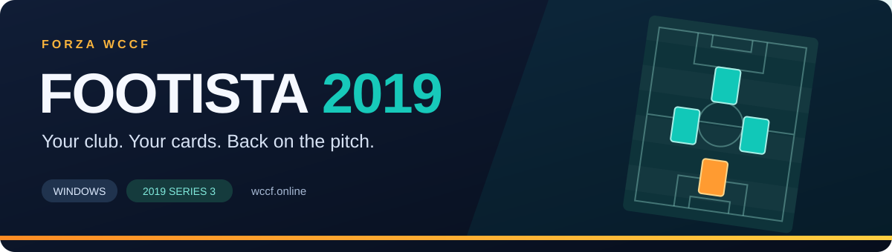

  <strong>Public beta 0.2.19</strong> &nbsp; · &nbsp;
  <a href="https://github.com/Forza-WCCF/FOOTISTA-2019/releases/tag/v0.2.19"><strong>Release and downloads</strong></a>
  &nbsp; · &nbsp;
  <a href="https://github.com/Forza-WCCF/FOOTISTA-2019/releases/download/v0.2.19/installer.zip"><strong>Download installer.zip</strong></a>

  

  <a href="https://wccf.online/misc.php?action=wccf_downloads"><b>Downloads</b></a>
  &nbsp; · &nbsp;
  <a href="docs/installation.md"><b>Installation guide</b></a>
  &nbsp; · &nbsp;
  <a href="docs/troubleshooting.md">Get help</a>
  &nbsp; · &nbsp;
  <a href="CHANGELOG.md">Changes</a>

# FOOTISTA 2019

Play **WCCF FOOTISTA 2019, version 1.30.01 / 2019 Series 3**, on a Windows PC with the Forza-WCCF community client and [wccf.online](https://wccf.online).

The client adds a club picker, a formation panel for your cards, English text and signed updates. Your website account connects your clubs to your PC; each club keeps its own game profile and printer history.

> **Public beta 0.2.19:** [Download the installer](https://github.com/Forza-WCCF/FOOTISTA-2019/releases/download/v0.2.19/installer.zip) · [Release notes](https://github.com/Forza-WCCF/FOOTISTA-2019/releases/tag/v0.2.19). The installer is about 50 MB and includes the client archive. Supply the game separately using the guide below.

## What you get

| Feature | In the client |
| :--- | :--- |
| **Your clubs** | Approve your PC on the website, then choose a club in the club picker. |
| **Formation panel** | Your usable saved printed cards appear on a clean PC too. Put them on the pitch, move them and return them to the available cards. |
| **Satellite and Terminal** | Play matches in Satellite mode; open Terminal for scouting, your card list and club options. |
| **English** | Translated tutorials, story subtitles and Terminal screens. Some later screens still need visual checks. |
| **Card progression** | Scouting, printing and rank-up work with your club's saved cards. |
| **Signed updates** | The client verifies its publisher, files and archive before applying an update. |

Basic tutorials, match saves, logout, title changes, scouting and Terminal sorting/filtering have been tested in the game. The clean-install check also verified website approval, saved-card recovery without local print images, a CPU match save and Terminal readback. **Matches between two real PCs still need testing**; this page does not promise working PvP.

## Start here

1. Read the [requirements and installation guide](docs/installation.md).
2. Prepare the **1.30.01 game archive** and the separate **ICF / OS Update** downloads described there.
3. Download **`installer.zip`** from the website or this repository's Releases. Extract it and run **`Install-FOOTISTA.cmd`**.
4. Open **`MANAGE-CLUBS.cmd`**, choose **Connect**, and approve the displayed code through your signed-in website account.
5. Choose your club and select **Play Satellite** or **Open Terminal**.

The game is supplied separately. The installer accepts a local `.7z`, `.zip` or extracted folder; it does not download the large game for you. The [installation guide](docs/installation.md#game-downloads) explains exactly which MEGA files to select.

## Before you download

| | What to expect |
| :--- | :--- |
| **Client download** | About 50 MB for the installer; it includes the client update archive. Players installing for the first time need only `installer.zip`. |
| **Game download** | The MEGA game archive shown in the guide is about 25.6 GB, plus separate supporting files. |
| **Disk space** | Extracting the game requires additional space. Setup checks the required space; keep the archive until installation succeeds. |
| **Internet** | Website approval, server requests, dependency installation and future client updates use the internet. Selecting an existing game folder does not re-download the game. |
| **Storage** | Complete extracted game files are reused. On the same drive, eligible files can be shared through hardlinks; those links do not duplicate the file contents. |

## Help and project information

- [Installation, requirements and MEGA layout](docs/installation.md)
- [Clubs, cards and switching PCs](docs/clubs-and-cards.md)
- [Troubleshooting](docs/troubleshooting.md)
- [Verify a download](docs/verification.md)
- [Report a problem](https://github.com/Forza-WCCF/FOOTISTA-2019/issues/new/choose)
- [Support and private information](SUPPORT.md)

This repository contains the public guides, release records and verification tools. Client packages are attached to Releases; GitHub's automatic **Source code** ZIP is the repository contents, not the installer. The client package includes its Python source. This repository does not mirror the game, player saves, credentials or publisher's private signing key.

A community project by [Forza-WCCF](https://github.com/Forza-WCCF), independent of SEGA and the original game's publishers. Game and football branding belong to their respective owners.
